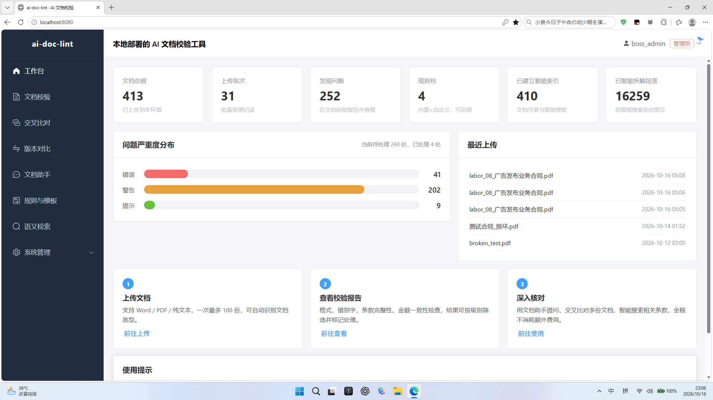
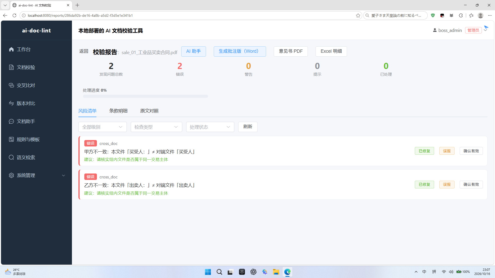
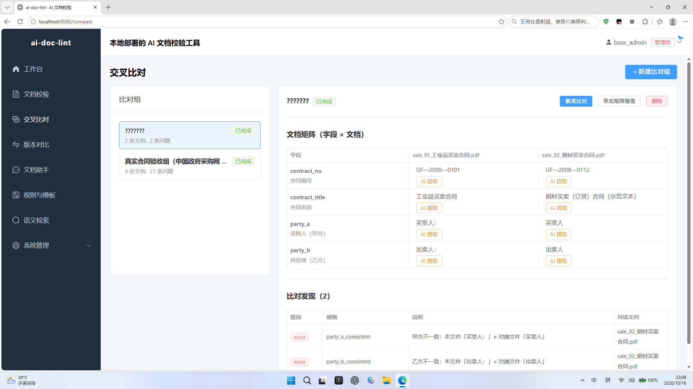

# ai-doc-lint

[](LICENSE)
[](https://github.com/Zhe713/ai-doc-lint/actions/workflows/ci.yml)
[](backend/pyproject.toml)
[](frontend)


> 开源自托管的 **AI 文档校验工具**：让 AI 做校对，行家做判断。
> 合同校验是第一个内置规则包，后续可通过规则包/模板扩展到招投标文件、规章制度、报告等场景。
>
> 数据全部留在部署方本地；大模型采用 BYOK（自带密钥，通过环境变量注入），项目本身不收集任何数据。

**开源协作**：[贡献指南](CONTRIBUTING.md) · [行为准则](CODE_OF_CONDUCT.md) · [安全策略](SECURITY.md) · [更新日志](CHANGELOG.md) · [面试 FAQ](docs/INTERVIEW_FAQ.md)

## 界面预览（真实运行截图）

| 首页看板 | 校验报告 |
| --- | --- |
|  |  |

| 交叉比对 |
| --- |
|  |

## 系统架构

```mermaid
flowchart TB
    User([用户浏览器]) -->|http://localhost:8080| Nginx

    subgraph 容器编排（docker compose 7 容器）
        Nginx[nginx<br>静态前端 + 反向代理 /api]
        API[api<br>FastAPI + SQLAlchemy]
        Worker[worker<br>Celery 四队列]
        Beat[beat<br>定时巡检]
        DB[(db<br>PostgreSQL 18 + pgvector)]
        Cache[(cache<br>Valkey/Redis)]
        Store[(storage<br>MinIO S3)]
    end

    Nginx -->|/api| API
    API --> DB
    API --> Cache
    API --> Store
    API --> Worker
    Beat --> Worker
    Worker --> DB
    Worker --> Store

    subgraph 能力分层
        Parse[解析流水线<br>txt/md · pdfium · docling · OCR]
        Check[校验核心<br>格式 / 错别字 / 条款 / 勾稽]
        Search[语义检索<br>bge 嵌入 + BM25 + 重排（0 token）]
        Learn[自学习闭环<br>反馈 → 调优 → golden 回归]
    end

    Worker --- Parse & Check & Search & Learn
```

## 当前进度（W1-W8 已完成；P1-P3 产品迭代已上线）

- **W1 工程骨架**：一键 Docker 部署栈（PostgreSQL 18 + pgvector、Valkey 9、MinIO、FastAPI、Vue3 前端）；
  初始化管理员、开放注册开关、用户名密码登录（JWT 双令牌）、两级 RBAC（管理员/成员）、登录失败限流、健康检查。
- **W2 异步任务体系**：Celery 四队列（parse/review/annotate/learn）+ Beat 定时巡检；
  批量上传受理（单批最多 100 份、在途配额、sha256 去重、.doc 老格式明确拒绝）；
  解析流水线（txt/md 直解、pdfium 文本探测、docling 结构化抽取、扫描件 RapidOCR 兜底，离线可用）；
  人工闸门三选一（OCR 重试 / 带警告继续 / 取消）；WebSocket + 轮询双通道实时进度；卡死任务巡检与断电恢复。
- **W3 校验核心**：格式检查器 + YAML/JSON 规则包；错别字检查器（混淆集/白名单/降级）；
  意图漏斗 L1/L2 流水线路由与落库；校验报告（发现列表、筛选、状态流转）。
- **W4 报告与批注**：规则预筛 + 批量 LLM 条款检查（引用防幻觉）；原生 docx 批注 + 检查清单下载；
  报告对话助手（三层意图漏斗 SSE）；LLM 客户端基座（重试/熔断/限流/用量日志）。
- **W5 交叉比对**：文档内勾稽（金额大小写、单价×数量、日期一致性，0 token）；
  跨文档比对组 + Celery 勾稽任务（当事人/金额/签订时序一致性，带关联文档定位）；
  字段抽取器（规则层 13 字段 0 token + LLM 批量补抽 + 引用反幻觉）。
- **W6 检索与规则管理**：pgvector 语义检索（本地 bge-small-zh-v1.5 嵌入，0 token）+ 文档级相似；
  规则包管理（CRUD、上传校验、启停、自定义包优先回落内置）；向量化基础设施与幂等重写。
- **W7 自学习闭环**：报告页反馈采集（误报原因：词典/规则过严/上下文/其他）；
  学习诊断看板（反馈分布、候选建议）；每日自动调优（白名单扩充 + 停用建议，先验证再生效）；
  golden 集版本化回归（manifest v1.0.0，40 份网络公开真实合同，api/worker/beat 只读挂载）。
- **W7-5 三项 P0 优化**：反馈原因结构化全链路（列 + API + 报告弹窗 + 看板分布 + 回归注入）；
  golden 版本化（报告展示版本号）；白名单先验证再生效（DB 信号 + golden 两级验证，未通过挂起人工）。
- **W8 监控与安全加固**：安全响应头（CSP / Frame-Options / nosniff / Referrer-Policy / Permissions-Policy）；
  上传 MIME 魔数校验（内容与扩展名不符即拒收，防伪装/损坏文件混入）；
  审计日志（登录成功/失败、注册、上传批次、系统设置变更、学习诊断，管理员可分页查询）；
  Prometheus 文本指标（/metrics，请求计数/延迟/任务状态/队列深度，仅聚合计数无敏感内容）；
  系统健康页（文档/任务分布/队列深度/依赖连接状态）。
- **图一前 3 项收尾**：数据保留自动清理（每日 04:30 定时清理过期文档，界面承诺兑现）；
  监控告警通知（队列积压/解析失败率/卡死心跳超阈值 → 告警事件表 + 健康页告警卡，5 分钟巡检）；
  CI/CD 流水线（GitHub Actions：后端 pytest + 前端 vue-tsc/build 双 job）。
- **P1 交互与页面重做**：报告页四段式工作台（总览看板 / 风险清单逐条销项 / 条款明细 / 原文对照三色高亮定位）；
  上传流程三步化（选文件 → 审查配置 → 提交成功）；批次记录胶囊化统计；原文预览兜底修复。
- **P2 技术增强**：混合检索（pgvector + BM25 + 本地 bge-reranker 重排，可开关降级）；
  解析插件化（注册表调度 + 质量基准集 parse_quality_report）；规则包 JSON 数据化 + 表单化 schema；
  golden 回归 F1 化（精确率/召回率/F1 + 标注口径冲突明细）。
- **P3 功能补齐**：版本 diff 比对（红绿渲染 + 无差异自动放行）；批量矩阵报告（上限 50 份 + CSV 导出含放行判定）；
  导出三件套（批注 docx + 意见书 PDF 含高管摘要 + Excel 明细双 Sheet，全部 0 token）；
  规则管理界面产品化（四类规则可视化配置 + 复制内置为自定义，无需手写 YAML）；
  首页/健康页看板化（6 统计卡 + 严重度分布条 + 处理进度 + 最近上传，点击直达报告）。

## 快速开始（Docker Desktop / Linux 均可）

前置要求：安装 Docker Engine 28+ 与 Docker Compose v2（本机已验证 Docker 29.8 / Compose v5.5）。```bash
# 1. 复制环境变量文件，并按需修改密钥/密码/大模型 Key
cp .env.example .env

# 2. 一键构建并启动（首次约 5-10 分钟，取决于网络）
docker compose up -d --build

# 3. 浏览器打开
#    http://localhost:8080
#    首次访问进入「初始化管理员」页面，仅可创建一次
```

服务与端口：

| 服务 | 地址 | 说明 |
| --- | --- | --- |
| 前端（Nginx） | http://localhost:8080 | 唯一入口，反向代理 `/api`，已内置安全响应头 |
| API 文档 | http://localhost:8080/docs | FastAPI 自动生成的接口文档 |
| API 健康检查 | http://localhost:8080/health | 依赖项连通性 |
| 监控指标 | http://localhost:8080/metrics | Prometheus 文本格式，仅聚合计数，可匿名抓取 |

## 演示模式（零成本）

一键脚本 `scripts-dev/demo_start.ps1`，覆盖本地演示与外网演示两种形态，无需任何云服务器：

```powershell
# 本地演示：检查 7 容器健康 + 自动打开浏览器
powershell -ExecutionPolicy Bypass -File scripts-dev\demo_start.ps1

# 外网演示：额外启动 Cloudflare 免费隧道，打印临时公网地址给观众
powershell -ExecutionPolicy Bypass -File scripts-dev\demo_start.ps1 -Remote
```

- 外网演示自动定位/下载 cloudflared（约 40MB，仅首次），生成 `*.trycloudflare.com` 随机域名；
- 演示结束 Ctrl+C 停止隧道，公网地址立即失效、无任何残留与费用；
- 项目定位为自托管数据不出域，演示数据与真实环境隔离即可。

## 常用命令

```bash
docker compose ps                 # 查看容器状态（应全部 healthy）
docker compose logs -f api        # 跟踪后端日志
docker compose exec api pytest    # 运行后端测试
docker compose down               # 停止（数据保留在命名卷中）
docker compose down -v            # 停止并删除全部数据（谨慎）
```

## 测试与验收

- 后端 pytest **163 用例全绿**，覆盖率 **71%**，CI 强制门禁 ≥70%
  （一键：`powershell -File scripts-dev/run_tests.ps1`，容器内运行并自动清理测试库残留连接）。
- 测试语料：CUAD 英文真实合同 510+ 份 + 政府采购公开合同 4 份 + 示范文本库（共 515 份，溯源清单 `manifest.csv`）；
  功能测试全部基于网络公开真实合同，禁止自造文件（golden 40 份 + diff/导出/矩阵实证均为公开合同）。
- Golden 回归集：`corpus/acceptance_golden/golden_manifest.json`（v1.0.0，40 份公开合同）；
  F1 回归脚本 `scripts-dev/golden_f1.py`（精确率/召回率/F1 + 标注口径冲突明细）。
- 验收交付物：`ux-review/` 下含新用户视角全功能体验测试报告、L3 业务价值代理指标、W7 学习闭环回归报告等。
- 安全与协作设施：GitHub Actions（测试+覆盖率门禁 / 前端构建 / CodeQL 扫描）、Dependabot 依赖自动更新、Issue/PR 模板。

## 目录结构

```
ai-doc-lint/
├── docker-compose.yml      # 一键编排（7 容器：api/worker/beat/db/cache/storage/nginx）
├── .env.example            # 全部环境变量（密钥只走这里）
├── backend/                # FastAPI + SQLAlchemy2 + Alembic + Celery + 校验器/学习闭环
│   └── tests/              # pytest 测试套件（160+ 用例，覆盖率 71%）
├── frontend/               # Vue3 + TS + Vite + Element Plus（按需引入，Nginx 托管）
├── docs/                   # 文档（含面试 FAQ、界面截图）
├── corpus/                 # 公开合同语料（整体 gitignore，manifest 与 golden 清单入库）
├── ux-review/              # 验收交付包（体验测试/业务指标/回归报告，HTML+JSON）
└── scripts-dev/            # 本地开发/测试/回归脚本（非分发内容）
```

## 安全与免责

- `.env` 已在 `.gitignore` 中，密钥不入库、不写日志；后台只显示掩码并提供连通测试。
- 上传文件做扩展名白名单 + MIME 魔数双重校验；关键操作（登录/上传/设置/学习诊断）全量审计留痕。
- 本工具输出为 AI 辅助校对结果，**不构成法律意见**，正式文件请由专业人员复核。

## License

[MIT](./LICENSE)
