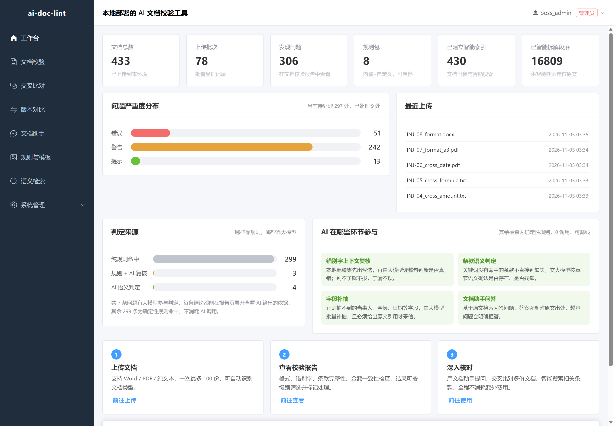
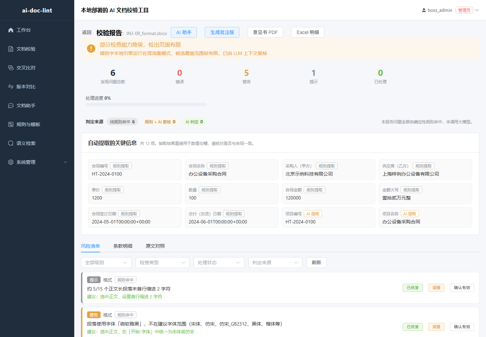
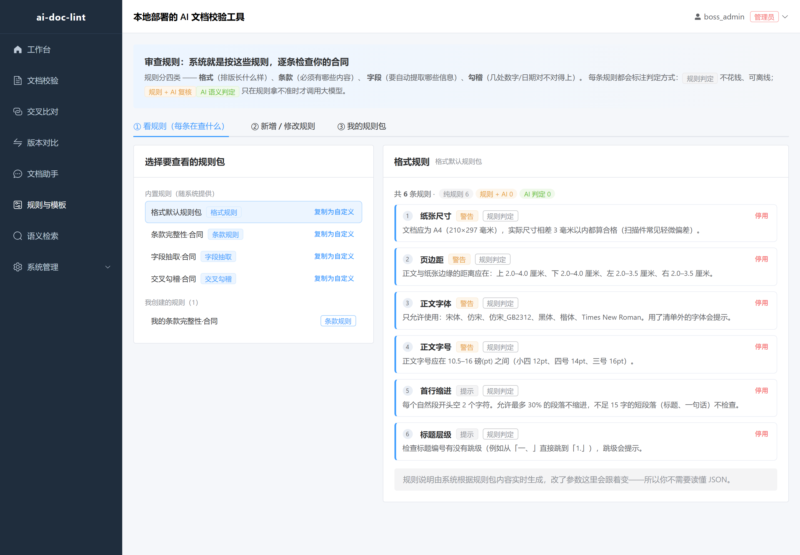
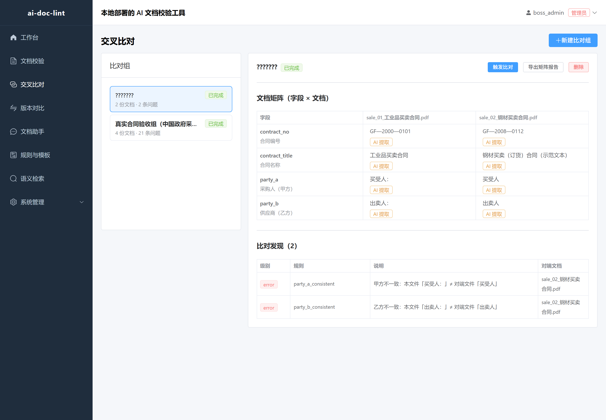

# ai-doc-lint

<p align="center">
  <strong>开源自托管的 AI 文档校验工具 —— 让 AI 做校对，行家做判断。</strong>
</p>

<p align="center">
  <a href="LICENSE"></a>
  <a href="https://github.com/Zhe713/ai-doc-lint/actions/workflows/ci.yml"></a>
  
  
  
  
  
</p>

---

## 这是什么

ai-doc-lint 是一个**自托管**的 AI 文档校验工具，把重复、枯燥的校对工作交给机器，把判断留给行家。

它做的事情：

- **格式检查**（0 token）：纸张、页边距、字体字号、首行缩进、标题层级——纯规则判定，离线可跑。
- **错别字检查**（本地候选 + AI 读整句裁决）：本地引擎先出候选，AI 结合上下文判断是否真是错别字，宁漏不误。
- **条款完整性**（强信号 0 token / 弱信号 AI 复核）：合同该有的条款缺没缺、换个说法算不算，分级处理。
- **交叉勾稽**（0 token）：金额大小写、单价 × 数量、日期先后等确定性核对，不花一分 token。
- **跨文档比对**：两份合同逐字段对比（当事人、金额、签订时序），差异红绿渲染，无差异可一键放行。
- **语义检索**：本地 `bge-small-zh` 向量 + BM25 + 重排，在文档里「换个说法」也能搜到，全程 0 token。

合同校验是第一个内置场景，通过规则包可以扩展到招投标文件、规章制度、报告等任何「有规则可依」的文档。

## 为什么是它

| 诉求 | ai-doc-lint 的做法 |
| --- | --- |
| **数据不出域** | 全部本地部署，文件、结果、审计日志都留在你自己的机器上 |
| **不用绑死某个大模型** | BYOK——自带密钥，`qwen` / `deepseek` 等 OpenAI 兼容接口填进 `.env` 即可 |
| **省钱** | 格式、勾稽、检索这些确定性检查 0 token；只有条款/错别字这类「真需要理解」的才调模型 |
| **可解释** | 每条问题都标注判定来源（规则 / 规则+AI / AI），并附 AI 判定理由，不是黑盒 |
| **会自我改进** | 你的「误报」反馈会进入学习闭环，自动扩充白名单、建议停用坏规则，且先跑回归验证才生效 |

> ⚠️ 输出是 **AI 辅助校对结果**，不构成法律意见，正式文件请由专业人员复核。

## 界面预览

| 首页看板 | 校验报告 |
| --- | --- |
|  |  |

| 规则管理 | 交叉比对 |
| --- | --- |
|  |  |

## 快速开始

前置要求：Docker Engine 28+ 与 Docker Compose v2。

```bash
# 1. 复制环境变量，按需修改密码、密钥、大模型 Key
cp .env.example .env

# 2. 一键构建并启动（首次约 5-10 分钟）
docker compose up -d --build

# 3. 打开浏览器
#    http://localhost:8080
#    首次访问进入「初始化管理员」，仅可创建一次
```

| 服务 | 地址 | 说明 |
| --- | --- | --- |
| 前端（Nginx） | http://localhost:8080 | 唯一入口，反向代理 `/api`，内置安全响应头 |
| API 文档 | http://localhost:8080/docs | FastAPI 自动生成的接口文档 |
| 健康检查 | http://localhost:8080/health | 依赖项连通性 |
| 监控指标 | http://localhost:8080/metrics | Prometheus 文本格式，仅聚合计数 |

### 没有云服务器？试试演示模式

`scripts-dev/demo_start.ps1` 一键搞定本地或外网演示，无需任何云资源：

```powershell
# 本地演示：检查 7 容器健康 + 自动打开浏览器
powershell -ExecutionPolicy Bypass -File scripts-dev\demo_start.ps1

# 外网演示：额外启动 Cloudflare 免费隧道，生成临时公网地址
powershell -ExecutionPolicy Bypass -File scripts-dev\demo_start.ps1 -Remote
```

## 系统架构

```mermaid
flowchart TB
    User([用户浏览器]) -->|http://localhost:8080| WebFE

    subgraph 容器编排（docker compose 7 容器）
        WebFE[web-frontend<br>nginx 静态前端 + 反向代理 /api]
        API[backend-api<br>FastAPI + SQLAlchemy]
        Worker[celery-worker<br>异步任务：解析 / 校验 / 批注 / 学习]
        Beat[celery-scheduler<br>定时巡检与调优]
        DB[(postgres-database<br>PostgreSQL 18 + pgvector)]
        Cache[(valkey-cache<br>Valkey：队列 + 缓存 + 限流)]
        Store[(minio-storage<br>MinIO S3 文件存储)]
    end

    WebFE -->|/api| API
    API --> DB
    API --> Cache
    API --> Store
    API --> Worker
    Beat --> Worker
    Worker --> DB
    Worker --> Store

    subgraph 能力分层
        Parse[解析流水线<br>txt/md · pdfium · docling · OCR]
        Check[校验核心<br>格式 / 错别字 / 条款 / 勾稽]
        Search[语义检索<br>bge 向量 + BM25 + 重排（0 token）]
        Learn[自学习闭环<br>反馈 → 调优 → golden 回归]
    end

    Worker --- Parse & Check & Search & Learn
```

**能力分层**（三层意图漏斗，能省则省）：

- **L1 规则直答**：格式、勾稽、检索等确定性能力，0 token；
- **L2 确定性补槽**：指代消解、槽位继承，靠状态机不靠模型；
- **L3 智能判定**：条款缺失、错别字裁决等真正需要理解的，才交给大模型。

## 技术栈

| 层 | 选型 |
| --- | --- |
| 后端 | FastAPI · SQLAlchemy 2 · Alembic · Celery · Pydantic |
| 前端 | Vue 3 · TypeScript · Vite · Element Plus · Pinia |
| 基础设施 | PostgreSQL 18 + pgvector · Valkey · MinIO |
| AI | 本地 `bge-small-zh` / `bge-reranker`（0 token）· BYOK 大模型（OpenAI 兼容） |
| 治理 | RBAC 两级 · JWT 双令牌 · 审计日志 · Prometheus · 告警 |

## 测试与质量

- 后端 pytest **179 用例全绿**，覆盖率 **73%**（CI 强制门禁 ≥ 70%）。
- **两套评测集，分工明确**：
  - `corpus/acceptance_golden`（40 份公开真实合同，**近似真值**）——用于回归对比，看有没有退化；
  - `corpus/injected_errors`（8 份合同、人工埋入 12 条已知错误，**精确真值**）——用于逐条对账，证明埋进去的错误确实查得出来。
  - 最新一轮注入集评测：**12 条全命中、0 误报**（7 条规则命中 + 3 条规则+AI 复核 + 2 条 AI 判定）。
- CI 流水线：后端 pytest（含覆盖率门禁）+ 前端类型检查与构建 + CodeQL 安全扫描。

```bash
docker compose exec backend-api pytest      # 运行后端测试
```

## 目录结构

```
ai-doc-lint/
├── docker-compose.yml      # 一键编排（7 容器）
├── .env.example            # 全部环境变量（密钥只走这里，不入库）
├── backend/                # FastAPI + Celery + 校验器 + 学习闭环
│   └── tests/              # pytest 测试套件（179 用例）
├── frontend/               # Vue3 + TS + Vite + Element Plus
├── docs/                   # 文档与界面截图
├── corpus/                 # 公开合同语料（正文不入库，manifest 与真值入库）
└── scripts-dev/            # 本地开发 / 测试 / 回归脚本
```

## 参与贡献

欢迎提 Issue 和 PR。请先阅读：

- [贡献指南](CONTRIBUTING.md)
- [行为准则](CODE_OF_CONDUCT.md)
- [安全策略](SECURITY.md)（发现漏洞请走这里，不要公开披露）
- [更新日志](CHANGELOG.md)

## 安全与免责

- 密钥只通过 `.env` 注入，不入库、不写日志；后台仅显示掩码。
- 上传文件做扩展名白名单 + MIME 魔数双重校验；登录、上传、设置等关键操作全量审计留痕。
- 本工具输出为 AI 辅助校对结果，**不构成法律意见**。

## License

[MIT](./LICENSE)
